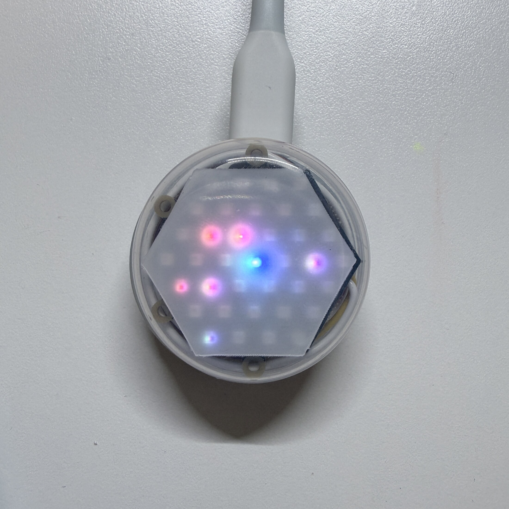

[English](README.md) | **日本語** | [简体中文](README.zh-CN.md) | [한국어](README.ko.md)

# BubbleWalk


BubbleWalkは、小型のM5Stackデバイスで構成する、固定インフラを必要としない
出会い可視化システムです。参加者はLEDデバイスを持ち歩き、スマートフォンで
トピックと意見を選び、Bluetooth Low Energy（BLE）で同期します。その後、
デバイス同士が短いBLEアドバタイズを直接交換します。各デバイスは、出会った
意見の要約をローカルに保存し、近くでの出会いをNeoHEXに表示します。

このリポジトリには、M5Stack Global Innovation Contest 2026向けに準備した
BubbleWalkの実装が含まれています。



## できること

1. 参加者がWeb Appでトピックと意見を選びます。
2. Web Appがトピック、色の対応、意見をNanoH2へ同期します。NeoHEXは、中心から
   外側へ広がるカラーブルームで転送完了を知らせます。
3. NanoH2同士が、ゲートウェイを介さずBLEで直接アドバタイズとスキャンを行います。
4. NeoHEX中央のLEDが、持ち主の意見の色を表します。
5. 出会ったデバイスは、RSSIによる近接度に応じて内側・中央・外側のLEDリングに
   現れます。新しい出会いは短いカラーポップで表示されます。
6. Web Appはデバイス内の出会いの要約を楽しいカラーパレットとして表示し、同時に
   保存された色がNeoHEX上を一周します。

得られるのは、デバイスを中心とした直接的な出会いの記録です。一般の人々を対象に
した投票ではなく、個人を特定することも目的としていません。

## ハードウェア

- M5Stack NanoH2 Dev Kit（1人につき1台。出会いのデモには複数台が必要）
- M5Stack Unit NeoHEX（RGB LED 37個、NanoH2 1台につき1台）
- HY2.0-4Pケーブル
- USB電源または適切な携帯電源
- Web Bluetooth対応ブラウザを使用できるスマートフォン、タブレット、またはPC

## リポジトリ構成

- `firmware/`：NanoH2 + NeoHEX用PlatformIO firmware
- `web-app/`：TypeScript/Vite製Web Bluetoothアプリケーション
- `assets/`：プライバシー確認済み・メタデータ削除済みのデモ画像

Web Appは、ヘッダーの展開式言語メニューから英語、日本語、簡体字中国語、韓国語を
切り替えられます。

## firmwareをビルドする

PlatformIOをインストールし、NanoH2を接続して実行します。

```sh
cd firmware
pio run
pio run -e participant -t upload --upload-port /dev/cu.usbmodemXXXX
```

書き込みポートは環境によって異なります。書き込み前に`pio device list`で確認して
ください。起動時、各デバイスは自身のハードウェアアドレスから実行時識別子を導出
するため、すべてのデバイスへ同じ`participant`バイナリを書き込めます。

## Web Appを実行する

Web Bluetooth APIを利用するには、HTTPSまたはlocalhostと、Web Bluetoothを
実装したブラウザが必要です。

```sh
cd web-app
corepack pnpm install --frozen-lockfile
corepack pnpm run test
corepack pnpm run dev
```

Viteが表示したlocalhostのURLを開きます。BubbleWalk裏面のボタンを短く押して、
同期ウィンドウを開きます。BubbleWalkに表示された1〜7の数字と、`Device 1`のような
ブラウザの選択画面の名前を照合します。iPhoneまたはiPadでは、BluefyなどのWeb
Bluetooth対応ブラウザを使用してください。

## デモの流れ

短いデモでは、次のように操作します。

1. 2台以上のNanoH2 + NeoHEXデバイスの電源を入れます。
2. 1台のiPadで**BubbleWalkに送る**を使い、異なる意見を選んで各デバイスへ同期します。
3. デバイス同士を近づけます。
4. 新しい意見の色が、対応するNeoHEXリングへ現れる様子を見ます。
5. Web Appのホーム画面へ戻り、**結果を読みだす**で任意のデバイスを選択して
   パレットを表示します。同時に、保存された色がNeoHEX上を一周します。

Web Appのホーム画面には両方のデバイス操作があり、進行役は1台のiPadでデモ全体を
進められます。

## プライバシーと範囲

- BLE通信はデバイス間で直接行われ、固定ゲートウェイは不要です。
- デバイスが保存するのはローカルな出会いの要約であり、名前ではありません。
- このリポジトリには、個人の回答、認証情報、APIトークン、デバイス固有の
  ハードウェアアドレスは含まれていません。
- Web Appは意見や出会いの結果をアップロードしません。

## 現在の状態

実装は7台のNanoH2 + NeoHEXデバイスで動作確認しています。リポジトリ内のWeb App
テストは、BLEペイロード処理、トピックと色のロジック、プライバシー閾値、ローカルな
デバイス保存を対象としています。公開インターフェースは、体験型デモ向けに設計して
います。

## プロジェクトページ

M5Stack Global Innovation Contest 2026のHacksterプロジェクトページとデモ動画は、
公開後にここへ掲載します。

## ライセンス

このプロジェクトは[MIT License](LICENSE)で公開しています。
