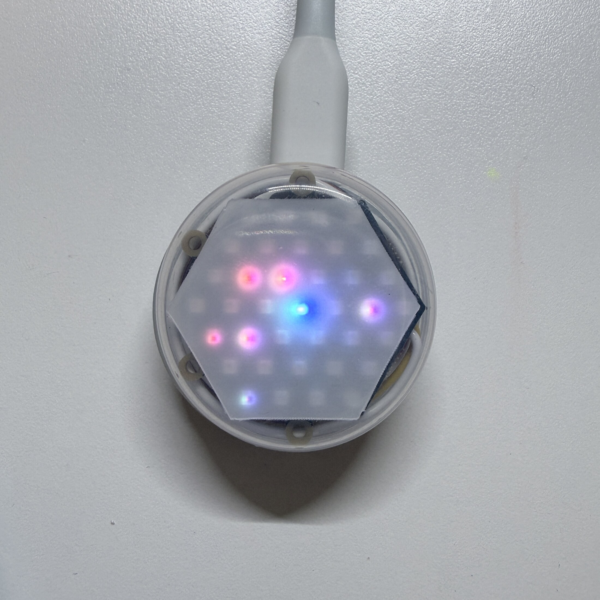

[English](README.md) | [日本語](README.ja.md) | [简体中文](README.zh-CN.md) | **한국어**

# BubbleWalk


BubbleWalk는 소형 M5Stack 기기로 구성된, 고정 인프라가 필요 없는 만남 시각화
시스템입니다. 각 참가자는 LED 기기를 들고 다니며 휴대전화에서 주제와 의견을
선택한 뒤 Bluetooth Low Energy(BLE)로 동기화합니다. 이후 기기끼리 짧은 BLE
광고를 직접 교환합니다. 각 기기는 만난 의견의 요약을 로컬에 저장하고, 가까운
만남을 NeoHEX 디스플레이에 표시합니다.

이 저장소에는 M5Stack Global Innovation Contest 2026을 위해 준비한 BubbleWalk
구현이 포함되어 있습니다.



## 주요 기능

1. 참가자가 Web App에서 주제와 의견을 선택합니다.
2. Web App이 주제, 색상 매핑, 의견을 NanoH2에 동기화합니다. NeoHEX는 중앙에서
   바깥쪽으로 퍼지는 컬러 블룸으로 전송 완료를 알립니다.
3. NanoH2 기기끼리 게이트웨이 없이 BLE 광고와 스캔을 직접 수행합니다.
4. NeoHEX 중앙 LED가 소유자의 의견 색상을 나타냅니다.
5. 만난 기기는 RSSI 기반 근접 단계에 따라 안쪽, 중간, 바깥쪽 LED 링에 나타납니다.
   새로운 만남은 짧은 컬러 팝으로 표시됩니다.
6. Web App은 기기에 저장된 만남 요약을 재미있는 컬러 팔레트로 보여 주며, 저장된
   색상은 동시에 NeoHEX 주위를 한 바퀴 돕니다.

결과는 해당 기기를 중심으로 한 직접적인 만남의 기록입니다. 일반 대중을 대상으로 한
투표가 아니며, 개인을 식별하기 위한 것도 아닙니다.

## 하드웨어

- M5Stack NanoH2 Dev Kit(1인당 1대, 만남을 시연하려면 여러 대 필요)
- M5Stack Unit NeoHEX(RGB LED 37개, NanoH2 1대당 1대)
- HY2.0-4P 케이블
- USB 전원 또는 적절한 휴대용 전원
- Web Bluetooth 지원 브라우저를 사용할 수 있는 휴대전화, 태블릿 또는 컴퓨터

## 저장소 구성

- `firmware/`: NanoH2 + NeoHEX용 PlatformIO firmware
- `web-app/`: TypeScript/Vite Web Bluetooth 애플리케이션
- `assets/`: 개인정보 검토 및 메타데이터 제거를 마친 시연 이미지

Web App은 헤더의 펼침형 언어 메뉴에서 영어, 일본어, 중국어 간체, 한국어로 전환할
수 있습니다.

## firmware 빌드

PlatformIO를 설치하고 NanoH2를 연결한 뒤 실행합니다.

```sh
cd firmware
pio run
pio run -e participant -t upload --upload-port /dev/cu.usbmodemXXXX
```

업로드 포트는 컴퓨터마다 다릅니다. 업로드 전에 `pio device list`로 확인하세요.
부팅할 때 각 기기는 자체 하드웨어 주소에서 런타임 식별자를 생성하므로, 모든 기기에
동일한 `participant` 바이너리를 기록할 수 있습니다.

## Web App 실행

Web Bluetooth API를 사용하려면 HTTPS 또는 localhost와 Web Bluetooth를 구현한
브라우저가 필요합니다.

```sh
cd web-app
corepack pnpm install --frozen-lockfile
corepack pnpm run test
corepack pnpm run dev
```

Vite가 표시한 localhost URL을 엽니다. BubbleWalk 뒷면의 버튼을 짧게 눌러 동기화
창을 엽니다. BubbleWalk에 표시된 1~7 숫자와 브라우저 선택 화면의 `Device 1` 같은
이름을 맞춥니다. iPhone 또는 iPad에서는 Bluefy와 같은 Web Bluetooth 지원
브라우저를 사용하세요.

## 시연 순서

짧은 시연은 다음 순서로 진행합니다.

1. NanoH2 + NeoHEX 기기 두 대 이상의 전원을 켭니다.
2. iPad 한 대에서 **BubbleWalk로 보내기**를 사용해 서로 다른 의견을 선택하고 각
   기기에 동기화합니다.
3. 기기들을 서로 가까이 가져갑니다.
4. 새로운 의견 색상이 해당 NeoHEX 링에 나타나는 모습을 확인합니다.
5. Web App 홈 화면으로 돌아가 **결과 읽기**로 기기를 선택해 팔레트를 표시합니다.
   동시에 저장된 색상이 NeoHEX 주위를 한 바퀴 돕니다.

Web App 홈 화면에 두 가지 기기 조작이 모두 있어 진행자는 iPad 한 대로 전체 시연을
운영할 수 있습니다.

## 개인정보 보호와 범위

- BLE 교환은 기기끼리 직접 이루어지며 고정 게이트웨이가 필요하지 않습니다.
- 기기는 이름이 아니라 로컬 만남 요약을 저장합니다.
- 이 저장소에는 개인 응답, 자격 증명, API 토큰, 기기별 하드웨어 주소가 없습니다.
- Web App은 의견이나 만남 결과를 업로드하지 않습니다.

## 현재 상태

이 구현은 NanoH2 + NeoHEX 기기 일곱 대에서 테스트했습니다. 저장소에 포함된 Web App
테스트는 BLE 페이로드 처리, 주제 및 색상 로직, 개인정보 보호 임계값, 로컬 기기 저장을
다룹니다. 공개 인터페이스는 체험형 시연을 위해 설계했습니다.

## 프로젝트 페이지

M5Stack Global Innovation Contest 2026 Hackster 프로젝트 페이지와 시연 영상은
공개 후 이곳에 연결할 예정입니다.

## 라이선스

이 프로젝트는 [MIT License](LICENSE)로 배포됩니다.
