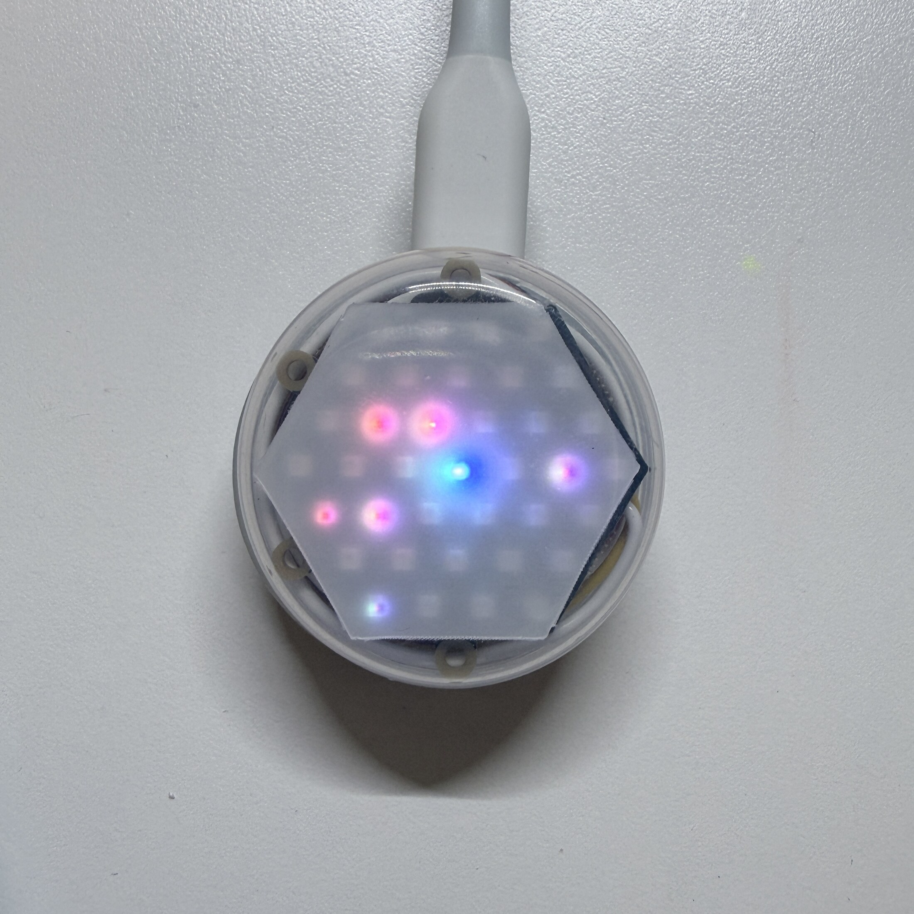

# BubbleWalk V1

BubbleWalk is an infrastructure-free encounter visualization system built with
small M5Stack devices. Each person carries an LED device, chooses a topic and
an opinion on a phone, and synchronizes that choice over Bluetooth Low Energy
(BLE). The devices then exchange short BLE advertisements directly. A device
keeps a local summary of the opinions it encountered and visualizes nearby
encounters on its NeoHEX display.

This repository contains the BubbleWalk V1 implementation prepared for the
M5Stack Global Innovation Contest 2026.



## What it does

1. A participant selects a topic and an opinion in the Web App.
2. The Web App synchronizes the topic, color mapping, and opinion to a NanoH2.
   NeoHEX confirms the transfer with a center-to-edge color bloom.
3. NanoH2 devices advertise and scan directly over BLE, without a gateway.
4. The center NeoHEX LED represents the owner's opinion color.
5. Encountered devices appear on inner, middle, or outer LED rings according
   to RSSI-based proximity bands. New encounters arrive with a short color pop.
6. The Web App turns the device's local encounter summary into a playful color
   palette, while the stored colors orbit once around NeoHEX.

The result is an ego-centric record of direct encounters. It is not a poll of
the general public and is not intended to identify people.

## Hardware

- M5Stack NanoH2 Dev Kit (one per person; multiple devices are needed to
  demonstrate encounters)
- M5Stack Unit NeoHEX (37 RGB LEDs, one per NanoH2)
- HY2.0-4P cable
- USB power or a suitable portable power source
- A phone or computer with a Web Bluetooth-capable browser

## Repository layout

- `firmware/`: PlatformIO firmware for NanoH2 + NeoHEX
- `web-app/`: TypeScript/Vite Web Bluetooth application
- `assets/`: privacy-reviewed demonstration photos with metadata removed

## Build the firmware

Install PlatformIO, connect a NanoH2, and run:

```sh
cd firmware
pio run
pio run -e participant -t upload --upload-port /dev/cu.usbmodemXXXX
```

The upload port varies by machine. Check it with `pio device list` before
uploading. On startup, each device derives its runtime identifier from its own
hardware address, so the same `participant` binary can be flashed to every
device.

## Run the Web App

The Web Bluetooth API requires HTTPS or localhost and a browser that implements
Web Bluetooth.

```sh
cd web-app
corepack pnpm install --frozen-lockfile
corepack pnpm run test
corepack pnpm run dev
```

Open the localhost URL printed by Vite. Press the NanoH2 G9 button briefly to
open its synchronization window, then select the `BW-participant-*` device from
the browser picker.

## Demo flow

For a short demonstration:

1. Power two or more NanoH2 + NeoHEX devices.
2. Choose different opinions in the Web App and synchronize each device.
3. Bring the devices near one another.
4. Watch each new opinion color pop onto the corresponding NeoHEX ring.
5. Reconnect with the Web App and reveal the palette; the stored colors orbit
   around NeoHEX at the same moment.

The Web App is intentionally a focused, single-flow showcase experience.

## Privacy and scope

- BLE exchange is device-to-device; no fixed gateway is required.
- The device stores local encounter summaries, not names.
- The repository contains no personal responses, credentials, API tokens, or
  device-specific hardware addresses.
- The Web App does not upload opinions or encounter results.

## Current status

The V1 implementation has been exercised with seven NanoH2 + NeoHEX devices.
The checked-in Web App tests cover BLE payload handling, topic/color logic,
privacy thresholds, and local device storage. The public interface is designed
for hands-on demonstration.

## Project page

The M5Stack Global Innovation Contest 2026 Hackster project page and demo video
will be linked here after publication.
