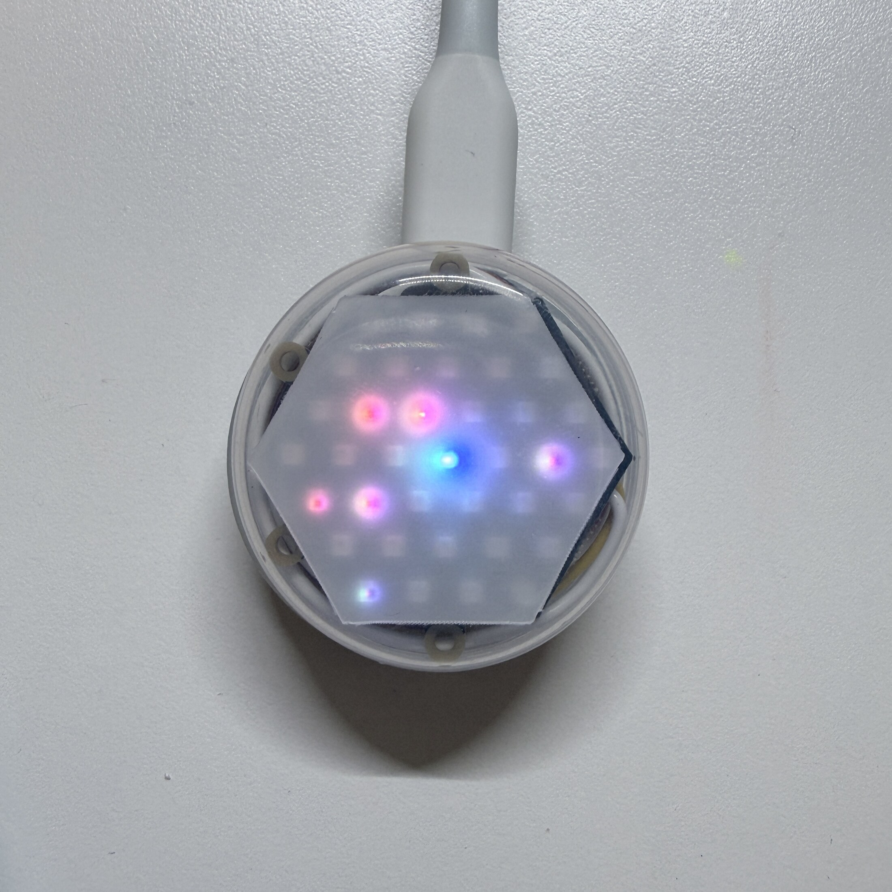

[English](README.md) | [日本語](README.ja.md) | **简体中文** | [한국어](README.ko.md)

# BubbleWalk


BubbleWalk是一套由小型M5Stack设备构成、无需固定基础设施的相遇可视化系统。
每位参与者携带一个LED设备，在手机上选择主题和意见，并通过Bluetooth Low
Energy（BLE）完成同步。随后，设备之间会直接交换短小的BLE广播。每台设备在
本地保存所遇意见的摘要，并通过NeoHEX显示附近的相遇。

本仓库包含为M5Stack Global Innovation Contest 2026准备的BubbleWalk实现。



## 功能

1. 参与者在Web App中选择主题和意见。
2. Web App将主题、颜色映射和意见同步到NanoH2。NeoHEX以从中心向外扩散的
   彩色光效确认传输完成。
3. NanoH2设备之间无需网关，直接通过BLE进行广播和扫描。
4. NeoHEX中央的LED代表持有者的意见颜色。
5. 遇到的设备会根据RSSI近距离等级显示在内圈、中圈或外圈LED上。新的相遇会以
   短暂的彩色弹出动画出现。
6. Web App将设备本地的相遇摘要转换为生动的调色板，同时已保存的颜色会在
   NeoHEX上环绕一周。

结果是以当前设备为中心的直接相遇记录。它不是面向公众的投票，也不用于识别个人。

## 硬件

- M5Stack NanoH2 Dev Kit（每人一台；演示相遇需要多台设备）
- M5Stack Unit NeoHEX（37颗RGB LED，每台NanoH2配一台）
- HY2.0-4P线缆
- USB电源或合适的便携电源
- 可使用Web Bluetooth浏览器的手机、平板电脑或计算机

## 仓库结构

- `firmware/`：NanoH2 + NeoHEX的PlatformIO firmware
- `web-app/`：TypeScript/Vite Web Bluetooth应用程序
- `assets/`：已完成隐私检查并移除元数据的演示图片

Web App可通过页眉中的展开式语言菜单切换英语、日语、简体中文和韩语。

## 构建firmware

安装PlatformIO，连接NanoH2，然后运行：

```sh
cd firmware
pio run
pio run -e participant -t upload --upload-port /dev/cu.usbmodemXXXX
```

写入端口因计算机而异。写入前请运行`pio device list`进行确认。启动时，每台设备
都会根据自身硬件地址生成运行时标识，因此所有设备都可以写入相同的`participant`
二进制文件。

## 运行Web App

Web Bluetooth API需要HTTPS或localhost，以及实现了Web Bluetooth的浏览器。

```sh
cd web-app
corepack pnpm install --frozen-lockfile
corepack pnpm run test
corepack pnpm run dev
```

打开Vite显示的localhost URL。短按BubbleWalk背面的按钮，打开同步窗口。
将BubbleWalk上显示的1至7数字与浏览器选择界面中`Device 1`之类的名称对应起来。
在iPhone或iPad上，请使用Bluefy等支持Web Bluetooth的浏览器。

## 演示流程

简短演示可按以下步骤进行：

1. 为两台或更多NanoH2 + NeoHEX设备接通电源。
2. 在一台iPad上使用**发送到BubbleWalk**选择不同意见，并同步到各台设备。
3. 将设备彼此靠近。
4. 观察新的意见颜色弹出到对应的NeoHEX环上。
5. 返回Web App首页，使用**读取结果**选择任意设备并显示其调色板；与此同时，
   已保存的颜色会在NeoHEX上环绕一周。

Web App首页同时提供两项设备操作，因此演示人员可以用一台iPad完成整个演示。

## 隐私与范围

- BLE交换在设备之间直接进行，无需固定网关。
- 设备保存的是本地相遇摘要，而不是姓名。
- 本仓库不包含个人回答、凭据、API令牌或设备专用硬件地址。
- Web App不会上传意见或相遇结果。

## 当前状态

该实现已在七台NanoH2 + NeoHEX设备上进行过测试。仓库中的Web App测试覆盖BLE
负载处理、主题与颜色逻辑、隐私阈值和本地设备存储。公开界面专为现场互动演示设计。

## 项目页面

M5Stack Global Innovation Contest 2026的Hackster项目页面和演示视频将在发布后
链接到这里。

## 许可证

本项目采用[MIT License](LICENSE)发布。
